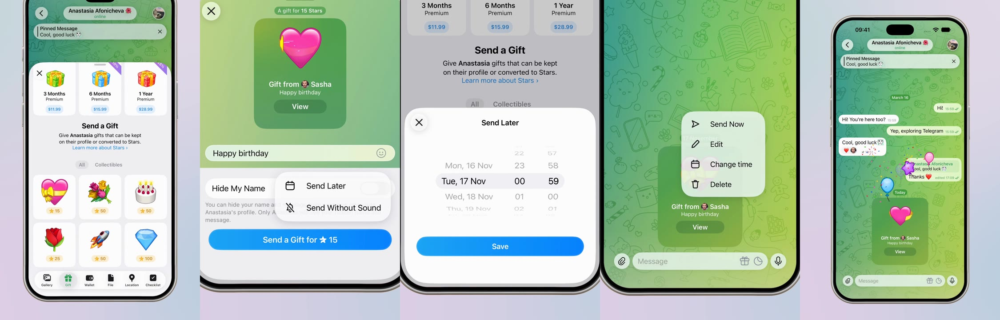

# Scheduled Gifts - send a Telegram gift later (iOS)

Pick a gift, write a message, then long-press the send button and choose Send Later: set the day and time on the
wheels and the gift waits in Scheduled Send. From there it can be sent now, edited, moved to another time or deleted;
once it is sent it lands in the chat with a burst of balloons.

▶︎ [Media/scheduled-gifts.mp4](Media/scheduled-gifts.mp4) - the flow in the iOS Simulator (1920×1920, 60 fps, 26 s).

A standalone SwiftUI concept app built from the Figma frames, in Telegram's look: SwiftUI, UIKit and WebKit only, no
third-party packages, no server. Three Swift files (about 2,000 lines), Telegram's animated stickers bundled with the
app. Builds with Xcode for the iOS Simulator (`еtelegram` scheme, Debug).

## How it works

- **The chat.** A chat with Anastasia in Telegram's style: glass header and composer buttons, the pinned message, the
  wallpaper, an animated 🌺 after the name. The gift button in the composer opens the gift sheet.
- **The catalog.** An edge-to-edge sheet: Gift Premium (3, 6 and 12 months) over animated stars, then Send a Gift with
  Heart, Bouquet, Cake, Rose, Rocket and Diamond, each an animated Telegram sticker with its price in Stars.
- **The gift.** Tapping a gift opens its preview: the card with the gift, a message field ("Your message (optional)")
  and Hide My Name. A tap on **Send a Gift for ★ 15** sends it right away.
- **Send options.** A long press on the same button grows a menu out of it, like a system context menu (scale, blur,
  spring and a haptic): Send Later and Send Without Sound. A tap outside closes it.
- **Send Later.** A sheet with three wheels: the day ("Tue, 17 Nov"), the hour and the minute, the hour and minute
  looping, all on `UIPickerView` for native momentum, snapping and haptics. It starts an hour from now. After Save the
  button reads **Send on 17 Nov at 00:59 for ★ 15**, and a tap schedules the gift.
- **Scheduled Send.** A calendar icon appears in the chat's composer and opens the scheduled messages: the gift under
  the day it is due. A tap on the card opens its menu: **Send Now**, **Edit** (the same preview, to change the message
  or the name setting), **Change time** (the wheels again) and **Delete** (with a confirmation).
- **Sending.** Sent now or from Scheduled Send, the gift appears in the chat under Today, and balloons fly up from it
  once the chat is back on screen. Tapping the card shows the gift's details.
- **Stickers.** Telegram's animated stickers (Lottie, decompressed from `.tgs`) are pre-rendered into `.stickerframes`
  files (WebP frames with a small header) and played natively with `CADisplayLink`, so the grid scrolls without
  dropped or half-drawn stickers. The star particles and the balloons are bundled HTML pages in a transparent web view.
  With Reduce Motion on, stickers and stars stay still.

## Repository

| Path | What |
|---|---|
| `еtelegram/` | The app's sources and resources. |
| `еtelegram.xcodeproj` | The Xcode project. |
| `Media/scheduled-gifts.mp4` | Demo. |
| `Media/preview.jpg` | Stills from the demo. |

Where the code lives:

| File | What |
|---|---|
| `MyApp.swift` | The app's entry point. |
| `ContentView.swift` | The chat, the gift catalog, the gift preview and its send options, Send Later, Scheduled Send and its menu, the gift details, the sticker player. |
| `GiftDatePicker.swift` | The Send Later wheels: day, hour and minute. |
| `gift_*.json`, `gift_*.stickerframes` | The gifts' animated stickers: Lottie data and pre-rendered frames. |
| `premium_gift_*_months.*` | The Premium gifts' stickers. |
| `hibiscus.*` | The 🌺 after the name. |
| `premium_stars.html`, `gift_balloons.html` | The stars behind the Premium header and the balloons on sending. |
| `lottie_light.min.js` | lottie-web, used to play stickers on macOS. |
| `Assets.xcassets` | Images and icons exported from Figma. |

## Run

Open `еtelegram.xcodeproj` in Xcode (iOS 27.2 SDK or later), pick the `еtelegram` scheme and an iPhone simulator, and
run. The project and target names start with a Cyrillic `е`.

## Notes and limits

- A design concept, not a change to the Telegram app: nothing is sent to a server, there are no Stars or payments, and
  the chat, the person and the balance are fictional.
- A scheduled gift is kept in the app's state only: it is sent with Send Now, not when its time comes, and it is gone
  when the app is closed.
- Only English strings; light mode only.
- Checked in the iOS Simulator: the whole flow in the demo, a clean Debug build. Not checked on a device.

## License

An unofficial concept, not affiliated with Telegram. Telegram's stickers and visual design belong to their owners.
